# CallBridge · .NET MAUI (Windows, iOS, Android)

[](https://github.com/gayatripatel10091992/maui-callbridge/actions/workflows/ci.yml)


The VoIP calling and texting app from [voip-callbridge](https://github.com/gayatripatel10091992/voip-callbridge)
(Kotlin), rebuilt in **.NET MAUI and C#**. One project targets **Windows, iOS and Android** (plus Mac Catalyst).
This mirrors my work at Cygnet.One, where I build the new .NET MAUI versions of a set of VoIP apps alongside their
native Android versions.

> Portfolio project. Original code with fictional data (555-01xx numbers); no client code, branding or APIs.

## Screenshots

One codebase, three platforms. CI builds each app on its own runner, opens every screen with the same
`callbridge://` link and commits the screenshots:

- **Android**: release APK on an API 34 emulator (Ubuntu runner).
- **iOS**: simulator build on an iPhone simulator (macOS runner), links opened with `simctl openurl`.
- **Windows**: unpackaged WinUI app (Windows runner), links passed on the command line.

| | Calls | In call | Plans |
|---|---|---|---|
| **Android** | 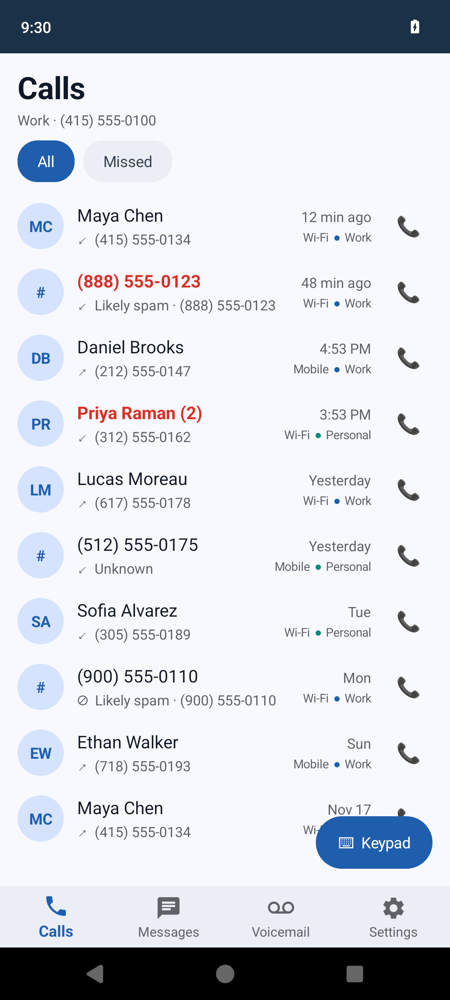 | 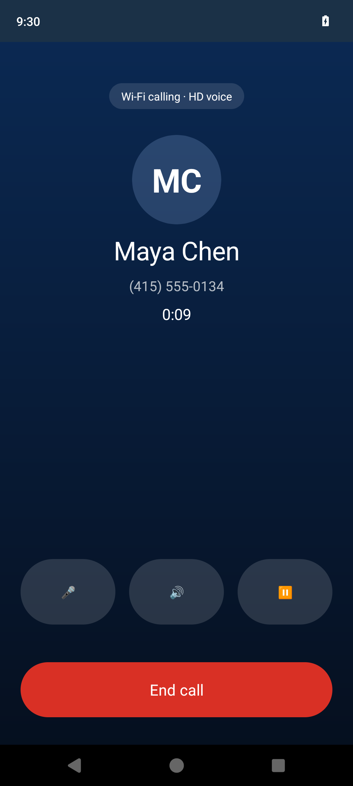 | 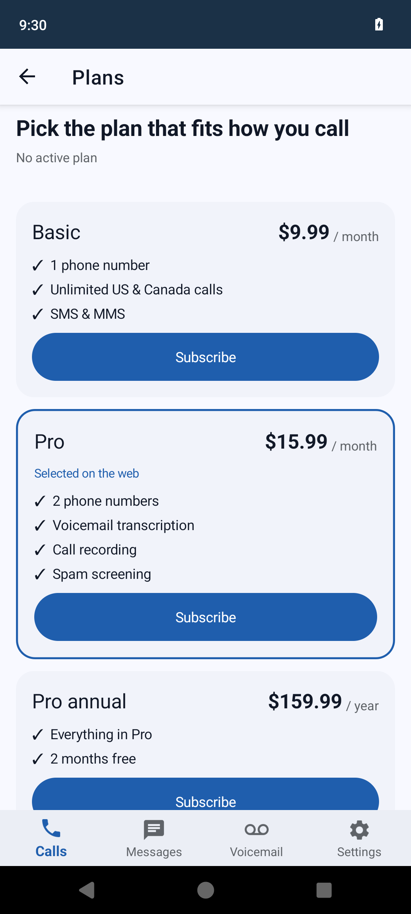 |
| **iOS** | 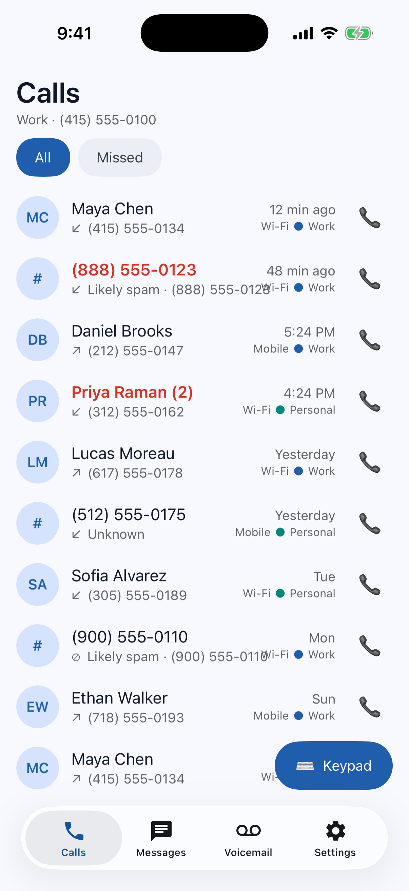 | 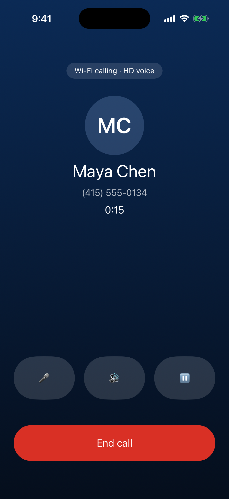 | 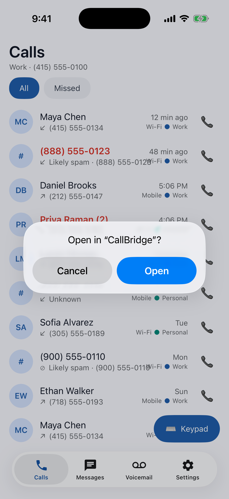 |
| **Windows** | 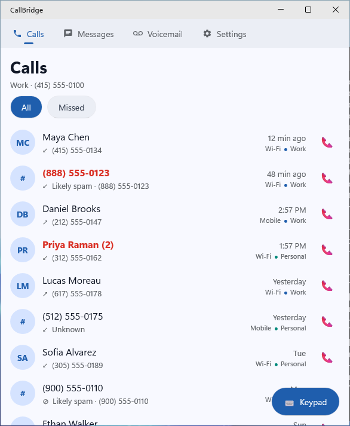 | 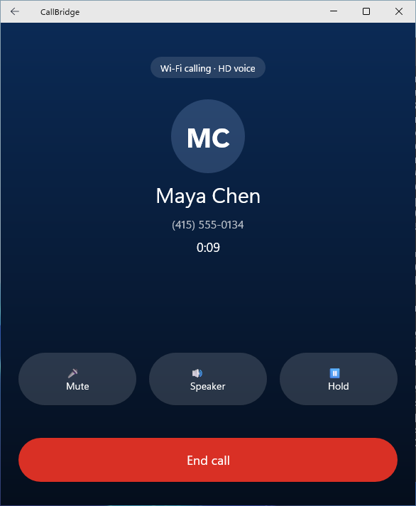 | 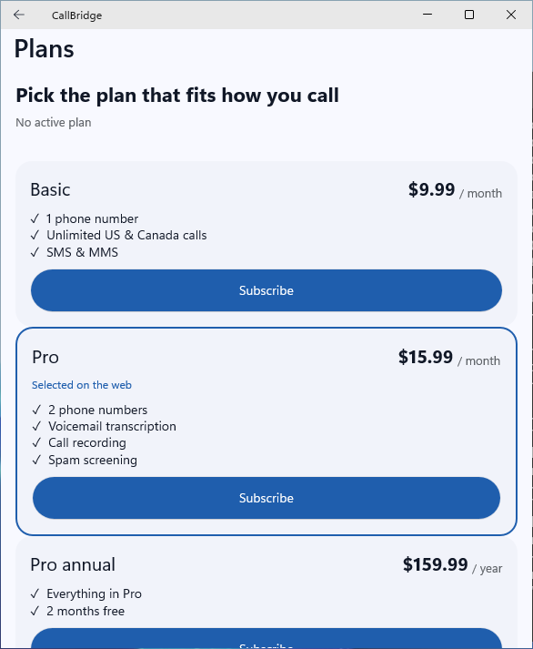 |

<details open>
<summary><b>Android</b>: all screens</summary>

| Calls | Messages | Voicemail | In call |
|---|---|---|---|
|  | 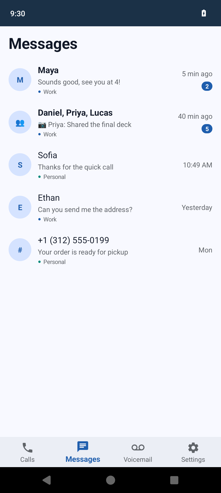 | 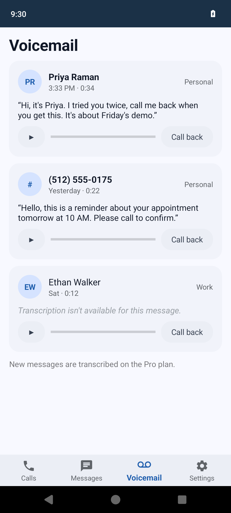 |  |

| Plans (from web signup) | Settings | Calls (dark) | In call (dark) |
|---|---|---|---|
|  | 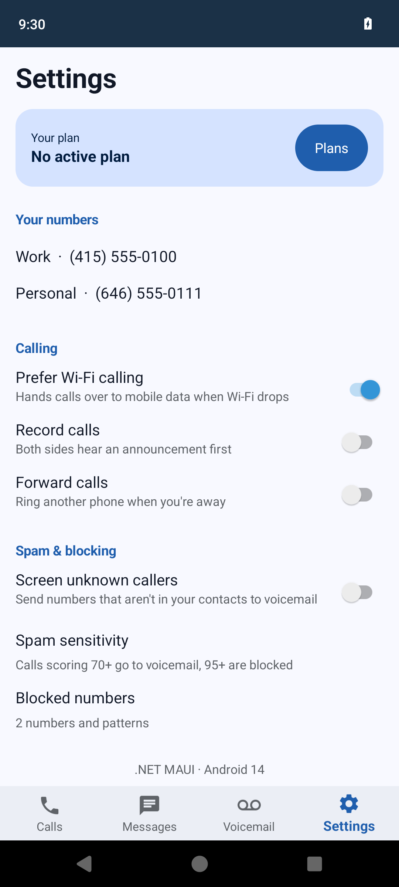 | 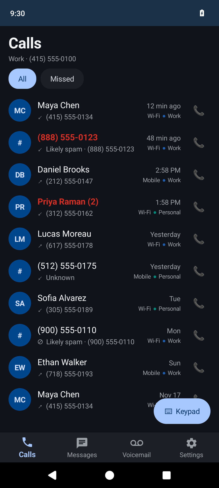 | 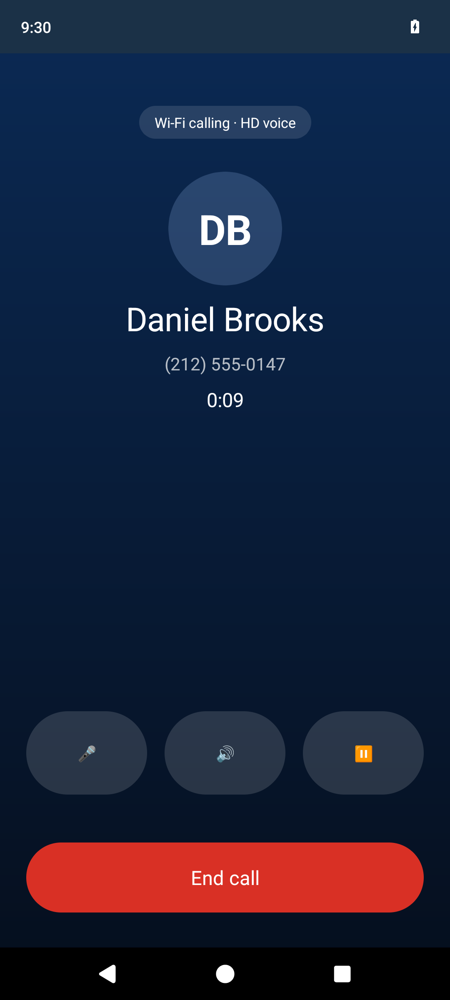 |

</details>

<details>
<summary><b>iOS</b>: all screens</summary>

| Calls | Messages | Voicemail | In call |
|---|---|---|---|
|  |  | 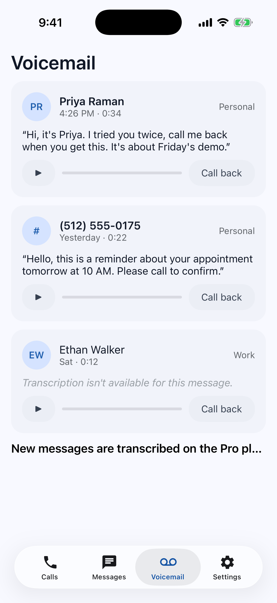 |  |

| Plans (from web signup) | Settings | Calls (dark) | In call (dark) |
|---|---|---|---|
|  | 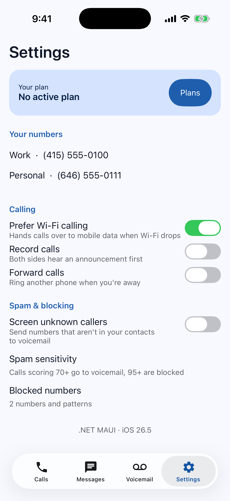 | 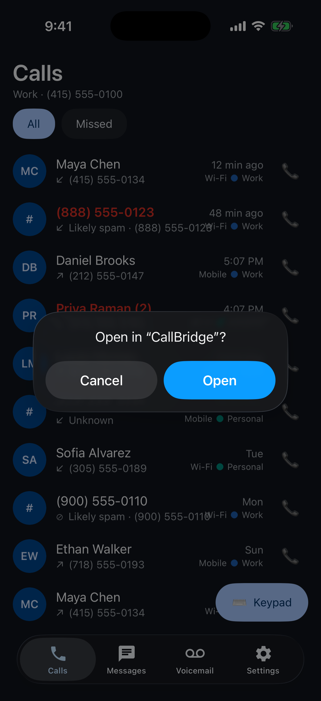 |  |

</details>

<details>
<summary><b>Windows</b>: all screens</summary>

| Calls | Messages | Voicemail | In call |
|---|---|---|---|
|  | 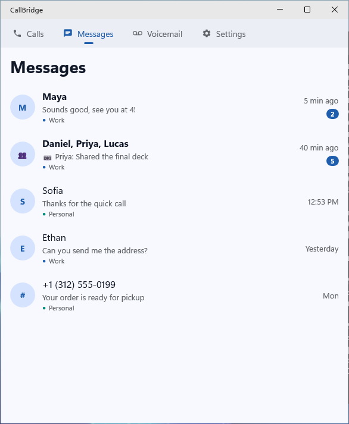 | 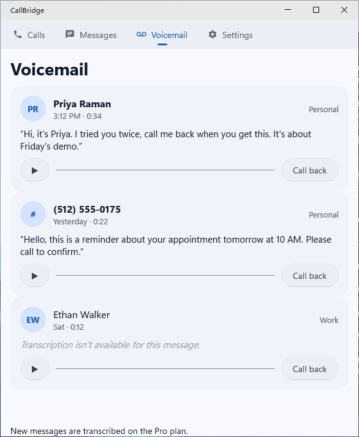 |  |

| Plans (from web signup) | Settings | Calls (dark) | In call (dark) |
|---|---|---|---|
|  | 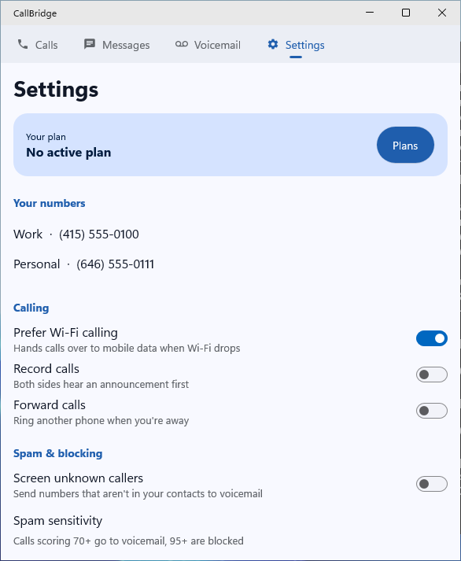 | 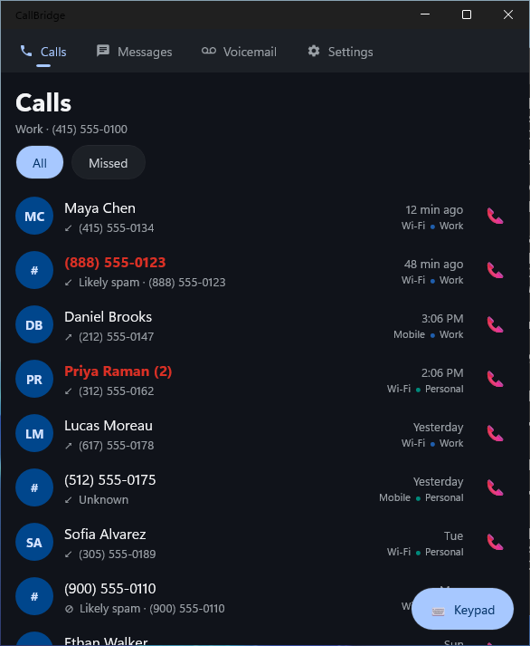 | 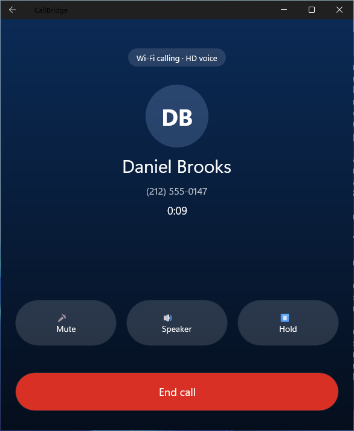 |

</details>

## Architecture

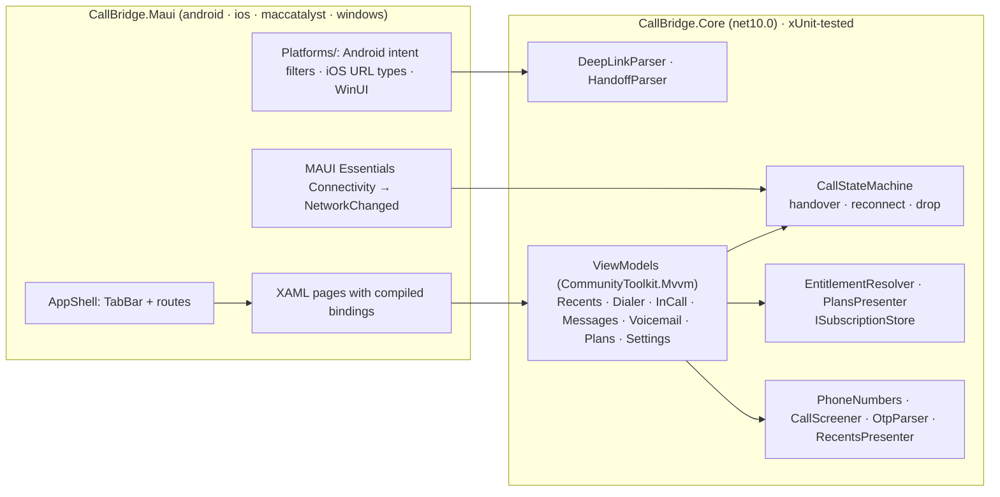

- **The core is the same design as the Kotlin app**, ported to C# records and pattern matching: the call state machine,
  subscription entitlement rules (upgrade now, downgrade at renewal, pending purchases never acknowledged), deep-link
  and web-handoff validation, spam screening, OTP parsing and call-log grouping.
- **View models are UI-framework free** (`net10.0`), so 30+ xUnit tests cover them without a device.
- **Platform code stays at the edges**: Android `[IntentFilter]`s and an iOS `OpenUrl` override feed one `DeepLinks`
  router; MAUI Essentials `Connectivity` feeds Wi-Fi/cellular changes into the state machine on every OS.
- **Stores**: `ISubscriptionStore` separates billing from the UI. The demo store follows the same plan-change rules on
  every platform; Google Play Billing, StoreKit 2 and the Microsoft Store each plug in behind it.

## CI

| Job | Runner | What it does |
|---|---|---|
| Core + view model tests | Ubuntu | `dotnet test` (xUnit) |
| Android | Ubuntu | Release APK, installed on an API 34 emulator; captures the Android screenshots |
| iOS | macOS | Simulator build with a workload set matched to the runner's Xcode; captures the iOS screenshots |
| Windows | Windows | Unpackaged WinUI app (`net10.0-windows10.0.19041.0`); captures the Windows screenshots |

## Build

```bash
dotnet test tests/CallBridge.Core.Tests
dotnet build src/CallBridge.Maui -f net10.0-android
dotnet build src/CallBridge.Maui -f net10.0-windows10.0.19041.0   # on Windows
dotnet build src/CallBridge.Maui -f net10.0-ios                    # on macOS with Xcode
```

Requires the .NET 10 SDK and `dotnet workload install maui`.

## License

MIT
